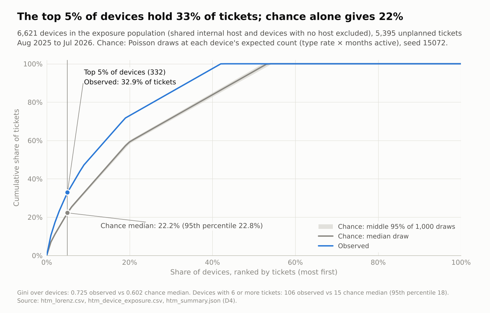
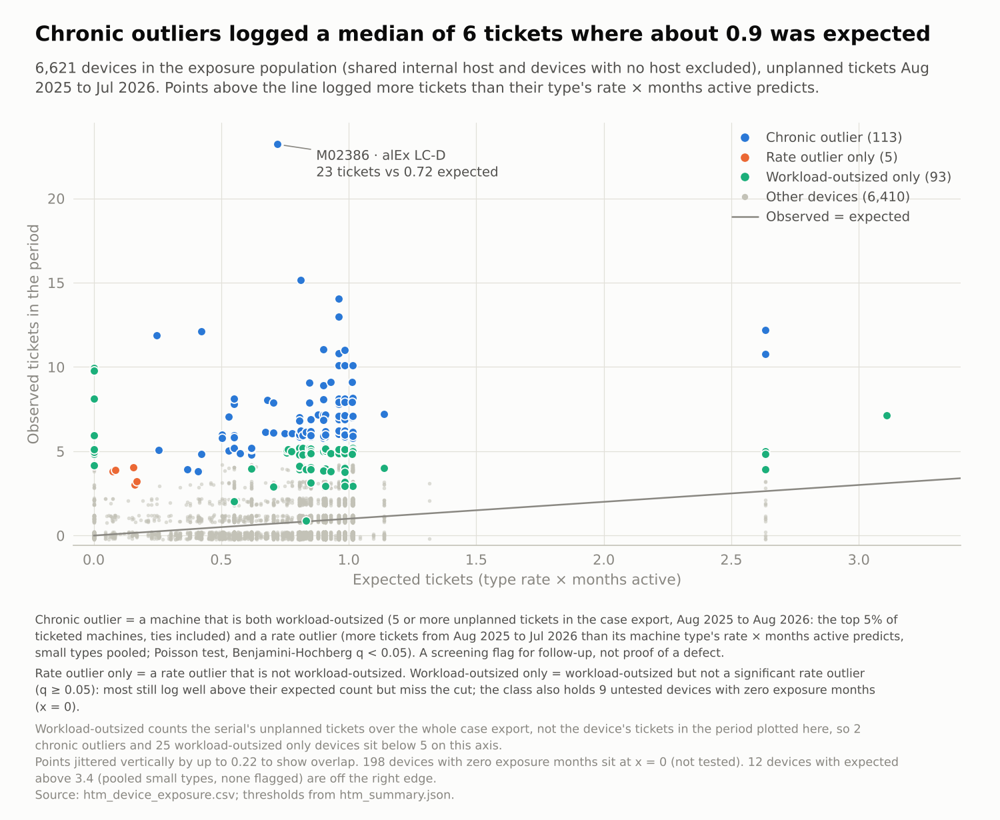
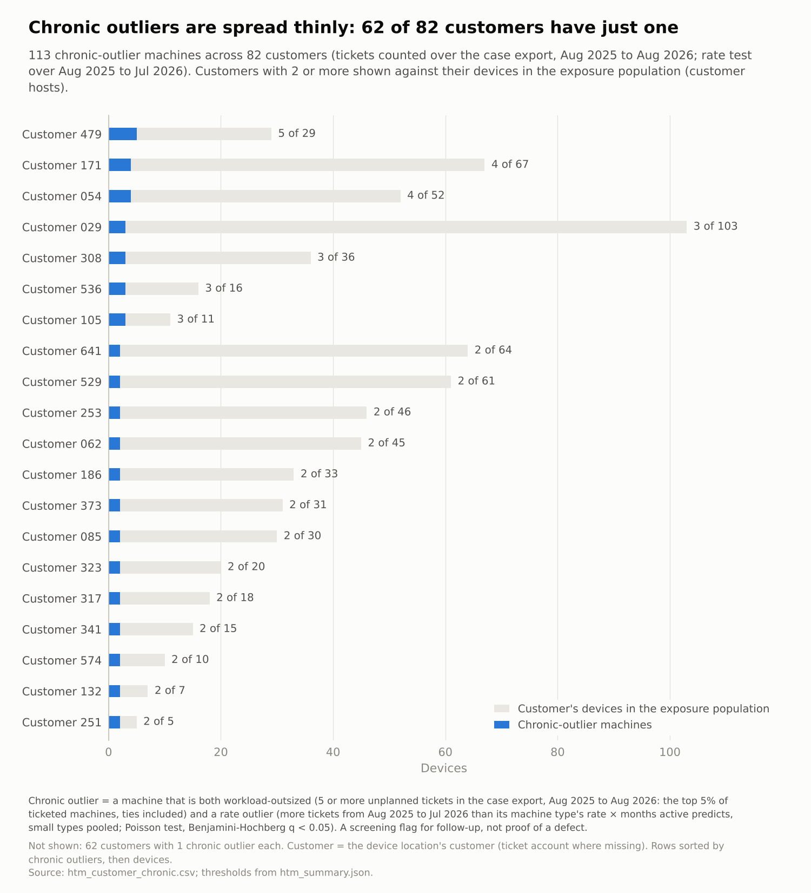
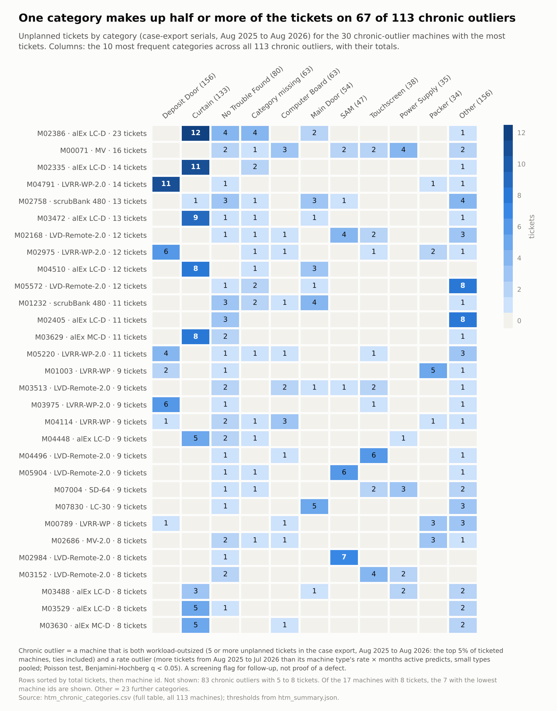
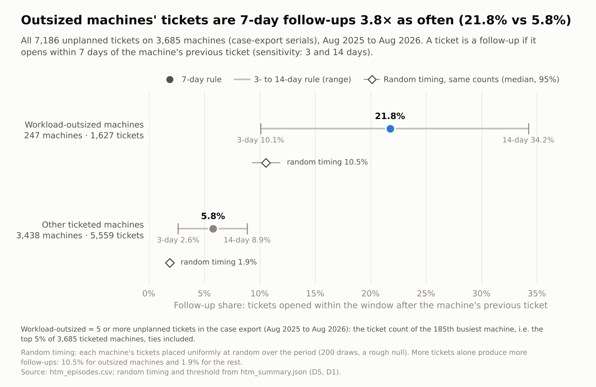
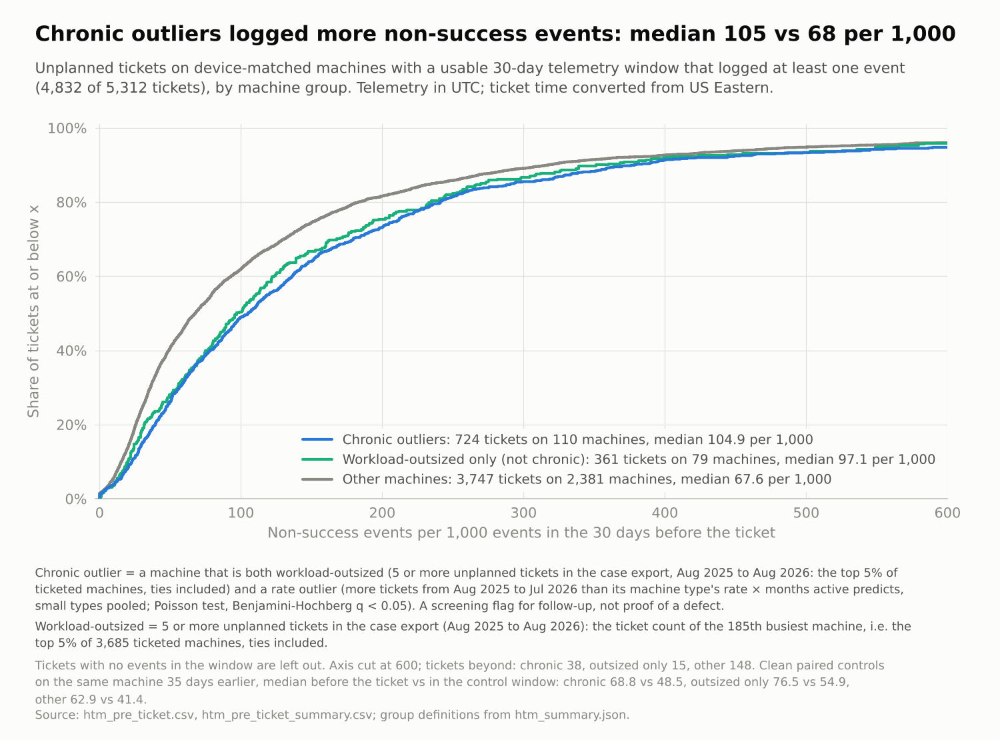
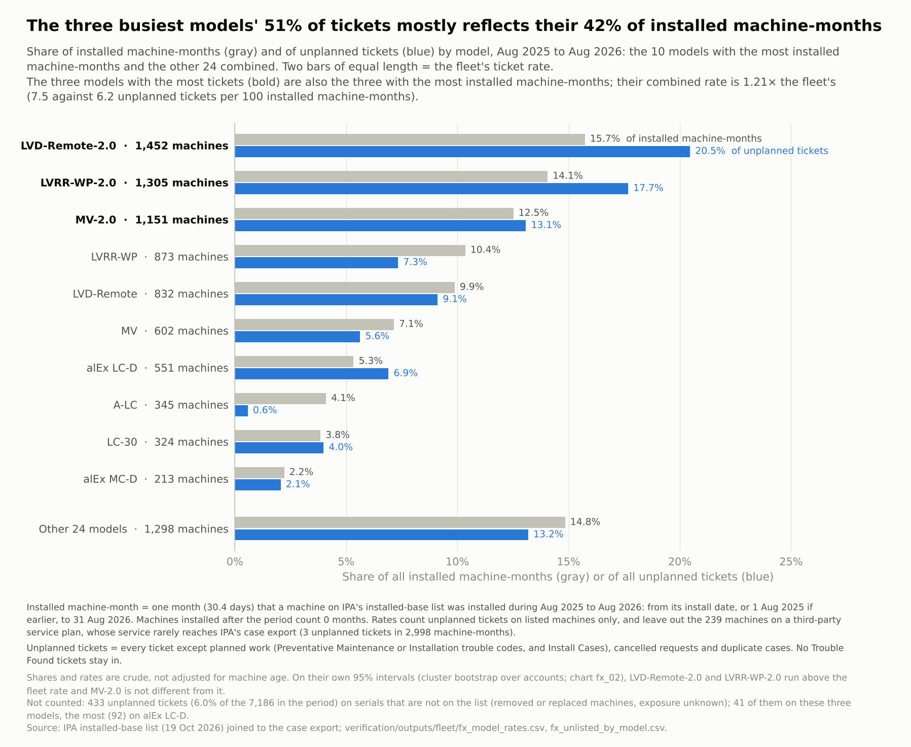
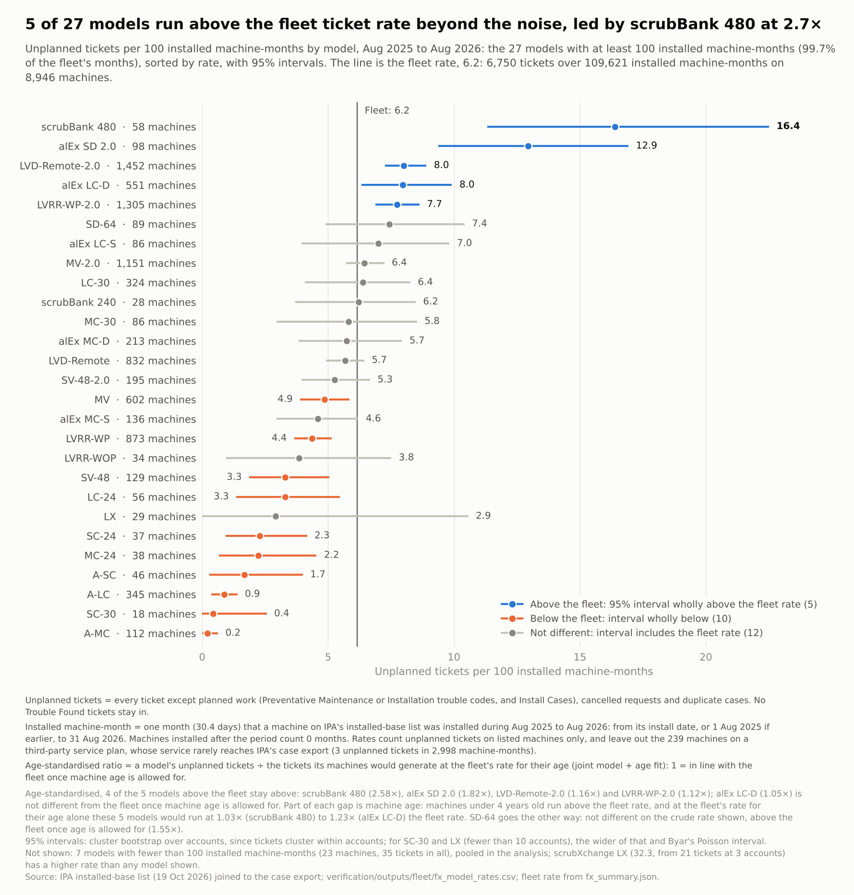
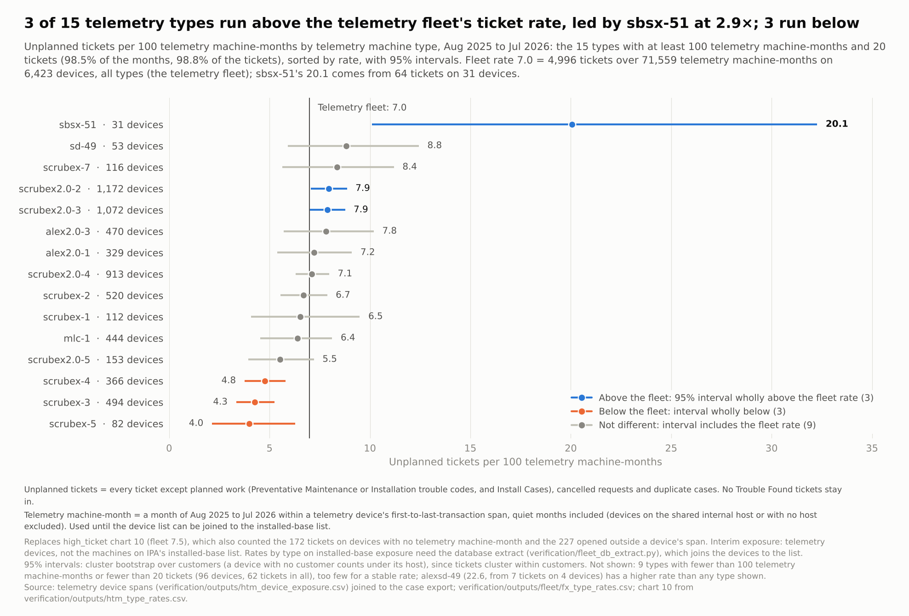

# Machines with an outsized share of service tickets

*Script: `verification/high_ticket_machines.py` (33 self-checks; it runs locally in about 20 s from the workbook and
the committed `fu_*` and `db_*` CSVs, with no database). Figures: `viz/figures/htm_*.png`, drawn by one plain
matplotlib script per chart in `viz/high_ticket/` (`htm_01_*.py` … `htm_08_*.py`; chart 6 writes two figures;
`run_all.py` draws them all) in the shared style of `viz/style/`. Charts htm_09 and htm_10 were retired on 21 October in favour of
`viz/fleet_exposure/` (see the update below). Every number below is in `verification/outputs/htm_summary.json` or an `htm_*.csv`, unless it is marked
as coming from the review pass.*

**Terms.** *Workload-outsized*: 5 or more unplanned tickets, the top 5% of ticketed machines. *Chronic outlier*: a
machine that is both workload-outsized and a rate outlier, i.e. it has more tickets than its machine type's rate ×
months active predicts (Poisson test, Benjamini–Hochberg q < 0.05). This is a screening flag for follow-up, not proof
of a defect. Every chart that uses either term prints its definition.

**How this was checked.** An independent clean-room build reproduced the populations, the outlier classes (the same
113 IDs) and the episode counts. Four skeptic reviews then examined stability, concentration against chance,
profile and episodes, and privacy. Each returned *holds with caveats*; the caveats are in the text below. The
robustness figures marked "review" come from the reviewers' scratch code. They are not yet in the committed
script.

> **Update, 21 October 2026.** IPA's installed-base list (19 October) gives install dates, models and accounts for
> 9,294 active machines. `docs/06_fleet_exposure.md` re-runs the exposure view on it (`verification/fleet_exposure.py`).
> The original text below is kept as the dated record; superseded statements are marked *[Updated 21 Oct]*.
> - **The flags hold up on installed exposure.**
>   - Of the 113 chronic outliers, 106 are in the installed-base population. 93 of those stay flagged when expected
>     tickets come from model and age instead of telemetry type and telemetry months.
>   - 30 are also *consistent outliers*: flagged under at least 10 of 12 method variants and above expected in
>     both halves of the period.
>   - On the list as a whole, 128 machines are flagged and 36 are consistent outliers.
>   - A negative-binomial check now flags none (the 14 October telemetry-based check left 2) (`fx_summary.json` machines, docs05_overlap).
> - **The 22 machines with under 12 months of exposure:**
>   - 19 are on the list. 7 were installed during the period, so their short exposure was real; 12 were installed
>     earlier and had quiet months.
>   - 16 of the 19 stay flagged.
> - **Persistence:** machines with 3 or more tickets in the first half had 2.6 times their expected tickets in the
>   second half. Permuting among machines of the same customer gives 1.45, so the excess is partly site-level and
>   partly the machine (`fx_outlier_machine_persistence.csv`).
> - **Charts htm_09 and htm_10 are retired.** Raw counts and telemetry-span rates are replaced by `fx_01` (share of the
>   installed base vs share of tickets), `fx_02` (rate by model, now computable) and `fx_05` (rate by telemetry
>   type).
> - **Model rates exist now.** Model is on the installed-base list, so rates by model no longer depend on tickets
>   (docs/06 §3).

## Bottom line
1. **Tickets are much more concentrated than chance.** That holds once machine type and months active are allowed
   for:
   - the top 5% of devices hold 32.9% of tickets, against 22.2% expected (95th percentile 22.8%);
   - 106 devices have 6 or more tickets, against about 15 expected.
2. **It is a continuum, not a distinct set of defective units.** Ticket rates vary widely between machines of the
   same type, even at the same customer. Under a model that allows for that spread (negative binomial), only 2
   machines stand out. *[Updated 21 Oct: on installed exposure, none.]*
3. **About 113 machines are worth a closer look: a watch-list, not a defect list.** Each is both in the top 5% by
   workload and well above its type's rate. *[Updated 21 Oct: 93 of the 106 on the list stay flagged on installed
   exposure and 30 are consistent outliers; see the update above.]*
   - About 70 of them stay on the list under almost every reasonable change of method; the other ~40 sit near the
     cut-offs.
   - They are spread over 82 customers, mostly one per customer, and across the main models.
   - On 67 of them a single category accounts for at least half of the tickets, so they tend to repeat the same
     fault.
4. **Usage does not explain it, and the pre-ticket telemetry shows no stronger warning sign.**
   - 30-day transaction volume barely predicts ticket counts.
   - High-ticket machines are somewhat busier and noisier in telemetry all the time. The rise in fault codes before a
     ticket is about the same as on other machines.
5. **Part of the excess is customer-level, and part is repeat contact.**
   - Differences between customers account for about a quarter of the excess concentration.
   - Much of the 6-or-more tail is tickets within a few days of each other.

## Two views of "outsized"
| View | Population | Definition | Result |
|---|---|---|---|
| **Workload** (D1) | 7,186 unplanned tickets on 3,685 ticketed machines, Aug 2025–Aug 2026 (ticket serials) | Machines at or above the ticket count of the 185th machine (top 5%), i.e. **≥5 tickets** | **247 machines, holding 22.6% of tickets** |
| **Exposure-adjusted** (D2) | 6,621 telemetry devices (7,183 less 411 on the shared internal host and 151 with no host); 71,559 device-months; 5,395 unplanned tickets, Aug 2025–Jul 2026 | Expected = machine type's ticket rate × months active (first to last transaction). Poisson upper tail, Benjamini–Hochberg q < 0.05 | **118 rate outliers** (2 under negative binomial) |

Combining the two views (D3):

| Class | Machines | Meaning |
|---|---|---|
| **Chronic outlier** | **113** | Workload-outsized **and** a rate outlier |
| Workload-outsized only | 93 | Workload-outsized, but not a significant rate outlier (q ≥ 0.05). Most still log well above their expected count (median about 5×) but miss the cut; 9 have no exposure months and were not tested |
| Rate outlier only | 5 | A rate outlier that is not workload-outsized: few tickets but very short exposure |

The workload view's top 5% hold 18.3% of tickets, and its top 10% and top 20% hold 29.4% and 45.6%. 147 machines have
6 or more tickets, 21 have 10 or more, and the maximum is 23.

The exposure view's top 5% figure (32.9%) is higher because its denominator also includes the 3,838 devices that had
no ticket at all.

## A. Concentration against chance (D4)
We simulated ticket counts 1,000 times with each device's expected value: type rate × months active.

| Statistic | Observed | Chance (median; 95th percentile) |
|---|---|---|
| Ticket share of the top 5% of devices (332) | **32.9%** | 22.2%; 22.8% |
| Gini coefficient | 0.725 | 0.602; 0.609 |
| Devices with ≥6 tickets | **106** | 15; 18 |

- **The result holds across the alternatives tried:**
  - restricting to devices with exposure;
  - the alternative rate numerator;
  - excluding the 137 monitoring-template tickets (top 5%: 31.8% against 22.4%);
  - in the review: exposure in days instead of months.
- **Customer differences** explain about 28% of the excess top-5% share (review). Part of this is under-reporting:
  devices with no customer mapping have 85 tickets against 422 expected.
- **Usage.** Measured 30-day transaction volume has an elasticity of about 0 for ticket counts (review). Only a
  model that forces tickets to rise one-for-one with volume matches the concentration, and the data contradict
  that.
- **Repeat contact.** Counting 7-day episodes instead of tickets cuts the ≥6 group from 106 to 61 (chance: 13). At
  30-day episodes the ≥6 excess disappears. The top-5% share remains above chance at every gap: 25.5% against 19.2%
  at 30 days (review).
- **Caveat on the chance benchmark.** The median of 15 for ≥6 is inflated by the pooled rate for small machine types:
  seven small types are pooled at 103.7 tickets per 100 months, which gives 13 devices an expected count of up to
  12.4. Without that artifact the median is 3, so the published comparison is conservative.

## B. How firm the 113 chronic outliers are
- **The count depends on the cut-off** (review): q < 0.01 gives 62, q < 0.10 gives 133, and a top-2.5% workload
  cut-off gives 104.
- **Robust core** (review): 71 machines stay on the list in at least 9 of 10 method variants, and 43 in all 10. The
  variants are exposure in days, dropping part-year devices, stricter or looser cut-offs, excluding monitoring or
  No-Trouble-Found tickets, and Zac's type rates. This core list is in scratch only: it is not committed and not yet
  reproduced by a second build.
- **How tickets are counted matters:**
  - excluding monitoring-template tickets leaves 87 (all of them in the 113); excluding No Trouble Found drops 25
    (review);
  - counting 7-day episodes drops 52 (review);
  - monitoring tickets are concentrated on these machines. Either monitoring finds real problems, or the monitoring
    process creates extra tickets.
- **Overdispersion.** Under a negative binomial fitted on the whole fleet, 2 remain (M02975 and M05572; both have
  under 6 months of exposure). The number depends on how the spread is estimated: 2 to 69 (review).
- **Customer adjustment** keeps 71 to about 100, depending on the estimator (review).
- **Exposure.**
  - 22 of the 113 have under 12 months of exposure.
  - 5 have tickets before their first transaction day.
  - Rates for short-exposure machines are fragile. Install and removal dates from IPA would fix this.
- **Persistence** (review): flagged machines stay elevated afterwards, but at about 2–5× their type average rather than
  the 8–12× seen in the flagging period. About half have no ticket in the following six months. These checks are small
  (61 and 33 tickets).

**Suggested wording:** "About 70 machines consistently generate far more tickets than their type and months active
predict; another ~40 are borderline."

## C. Profile
- **Tickets.** The 113 machines hold 859 unplanned tickets (median 7 per machine).
- **Models.** LVRR-WP-2.0 24, alEx LC-D 15, LVD-Remote-2.0 14, MV-2.0 14, LVRR-WP 10. alEx types are slightly
  over-represented, which matches the wide spread of ticket counts within those types (`htm_type_mix.csv`).
- **Categories.**
  - Curtain makes up 15.5% of chronic tickets against 6.0% elsewhere. Against each model's own category mix,
    though, the excess is only about 1.2×, and Deposit Door shows none.
  - The categories mostly reflect what each model typically breaks on.
- **Same fault, repeated.**
  - On 67 of the 113, one category accounts for at least half of the tickets; about 38 would be expected for those
    models (review).
  - `htm_chronic_top3.csv` lists each machine's top three categories.
- **Customers.** 82 customers, 62 of them with a single chronic machine.

  | Customer | Chronic machines | Devices (exposure population) |
  |---|---|---|
  | Customer 479 | 5 | 29 |
  | Customer 171 | 4 | 67 |
  | Customer 054 | 4 | 52 |

  Chronic machines cluster by customer no more than workload-outsized machines in general (review). For the 247 workload-outsized
  machines, the top five customers hold 12.2% against 8.1% by chance (95th percentile 10.1%).

## D. Episodes (D5)
Tickets on the same machine no more than 7 days apart count as one episode.

| | Workload-outsized (247) | Other ticketed machines (3,438) |
|---|---|---|
| Median tickets / episodes per machine | 6 / 5 | 1 / 1 |
| Follow-up share (tickets within an existing episode) | **21.8%** | 5.8% |
| Same, with random timing | 10.5% | 1.9% |
| 3-day / 14-day gaps | 10.1% / 34.2% | 2.6% / 8.9% |

- Relative to random timing, clustering is about 2× on outsized machines and about 3× on other machines.
- Most tickets on high-ticket machines are therefore separate episodes, not a single drawn-out incident.

## E. Telemetry before tickets
From `fu_ticket_last10.csv`: 30-day lookback on the corrected clock, 5,312 usable unplanned tickets.

| Group | Events in 30 days (median) | Non-success codes per 1,000, ticket window | Same, clean control 35 days earlier (paired) |
|---|---|---|---|
| Chronic (768 tickets) | 1,838 | 104.9 (paired: 68.8) | 48.5 |
| Workload-outsized only (not chronic) | 1,413 | 97.1 (paired: 76.5) | 54.9 |
| Other machines | 1,473 | 67.6 (paired: 62.9) | 41.4 |

- Chronic machines are busier and noisier at all times.
- The rise from control to ticket window is about +20 per 1,000 in every group, so they show no stronger warning
  sign.
- Door-issue codes appear in the last 10 codes of 73.6% of chronic tickets, against 65.6% of their controls. For
  other machines the figures are 68.1% and 61.3%.
- **Caveat.** Clean paired controls exist for only 21% of chronic tickets (163), against 72% of other tickets,
  because frequent tickets leave few clean 35-day-earlier windows.

## F. Which machine types generate the most tickets
*[Updated 21 Oct: charts htm_09 and htm_10 are retired. On tickets inside each device's span, the telemetry fleet
rate is 7.0, not 7.5: the 7.5 also counted 227 tickets opened outside a device's span and 172 on devices with no
exposure month. scrubex2.0-2, -3 and -4 are 7.9, 7.9 and 7.1, and sbsx-51 is 20.1 on 31 devices (chart fx_05).
Rates by model on installed exposure are in docs/06 §3 and charts fx_01 and fx_02. The text of this section is
kept as the 14 October record.]*

**Charts 9 show raw counts, which are not adjusted for fleet size.** A type can rank high simply because many machines
of that type are installed. Chart 10 adjusts for this with machine-months.

- **By model**, as recorded on tickets: LVD-Remote-2.0, LVRR-WP-2.0 and MV-2.0 generate 49% of the 7,186 unplanned
  tickets (1,393, 1,211 and 897).
  - Model is recorded only on tickets, so the number of installed machines per model is unknown. *[Updated 21 Oct:
    IPA's installed-base list gives every machine's model; rates by model are in docs/06 §3.]*
  - Per-machine rates by model therefore cannot be computed from these data.
- **By telemetry machine type:** scrubex2.0-2, scrubex2.0-3 and scrubex2.0-4 generate 52% of the 5,921 tickets
  matched to a telemetry device.
- **Machine-month:** one month of a machine in service. Each telemetry device counts the calendar months from its
  first to its last transaction within Aug 2025–Jul 2026, both included, so a machine active all year adds 12.
- **Adjusting for exposure with machine-months** (chart 10, `htm_type_rates.csv`) changes the reading:
  - those three types are also 48% of the exposure-population devices and of their machine-months;
  - their rates are 8.5, 8.2 and 7.6 tickets per 100 machine-months, only modestly above the fleet's 7.5 (+12%, +9%,
    +0%; the first two are above it even allowing for chance). Their 52% share of tickets against 48% of
    machine-months shows their lead in raw counts is mostly fleet size;
  - sd2.0-49, 10th by raw count, is not in chart 10: 88 of its 89 devices never transact in the window, so its
    exposure cannot be measured from telemetry;
  - the highest rate among types with at least 100 machine-months is sbsx-51: 21.9 per 100 machine-months, on 33
    devices.

## Questions for IPA
1. **Field check of the robust core.** *[Updated 21 Oct: superseded by the field check of the 36 consistent-outlier
   machines and 18 consistent-outlier customers in docs/06 §8, ask 7. 30 of the 36 machines are among these 113.]*
   - Do the field service team recognise these machines (real names in the local deliverable
     `deliverables/htm_chronic_outliers_by_customer_REALNAMES.png`)?
   - Are they known problem units, sites with heavy use or training issues, or sites that simply report more?
   - *Why:* only IPA can say whether the statistical signal matches known reality.
2. **Monitoring tickets.** How are "Monitoring – Daily/Poll" tickets created?
   - *Why:* they are concentrated on these machines, and 26 of the 113 depend on them.
3. **Install and removal dates.** Install and decommission dates per serial. *[Updated 21 Oct: install dates
   received with the installed-base list; removal dates for machines no longer active are still needed.]*
   - *Why:* 22 flagged machines have under 12 months of exposure, and some have tickets outside their telemetry
     span. Both negative-binomial survivors are among these.
4. **Ticket rollovers.** Are tickets opened within hours of the previous one closing re-opens or rollovers rather
   than new visits?
   - *Why:* this decides whether to count tickets or episodes.

## Limits
- Exposure comes from first and last transaction dates. Gaps are counted, overstating active months by about 3%
  (71,559 against Zac's 69,155).
- Model is known only for ticketed machines. *[Updated 21 Oct: the installed-base list gives every listed machine's
  model.]*
- The usage proxy exists only for devices with a matched ticket.
- Measuring usage and fault-code rates for machines **without** tickets, and active months that account for gaps,
  would need another database run. That is deferred, following the decision to avoid Colab.
- The customer is the device location's current account (`devices.location_name`), a snapshot (`docs/03`).

## Privacy
- **Public files.**
  - Public tables carry only pseudonyms (M#####, S#####, Customer NNN, Host NNN) and aggregates.
  - The script's final check (`text_leaks`) tests every text cell, and every token within a cell, against all
    real serials, account names and case numbers.
  - A separate scan of the outputs, the scripts and this document found no real identifiers.
- **Crosswalk.** These tables are the first committed files that pair S##### with M#####. Both are pseudonyms of the
  same serials, so the pairing reveals nothing without the private lists.
- **Real names.** Real names and serials exist only in gitignored `data/private/htm_private_*.csv` and in the
  real-name chart in `deliverables/`.
