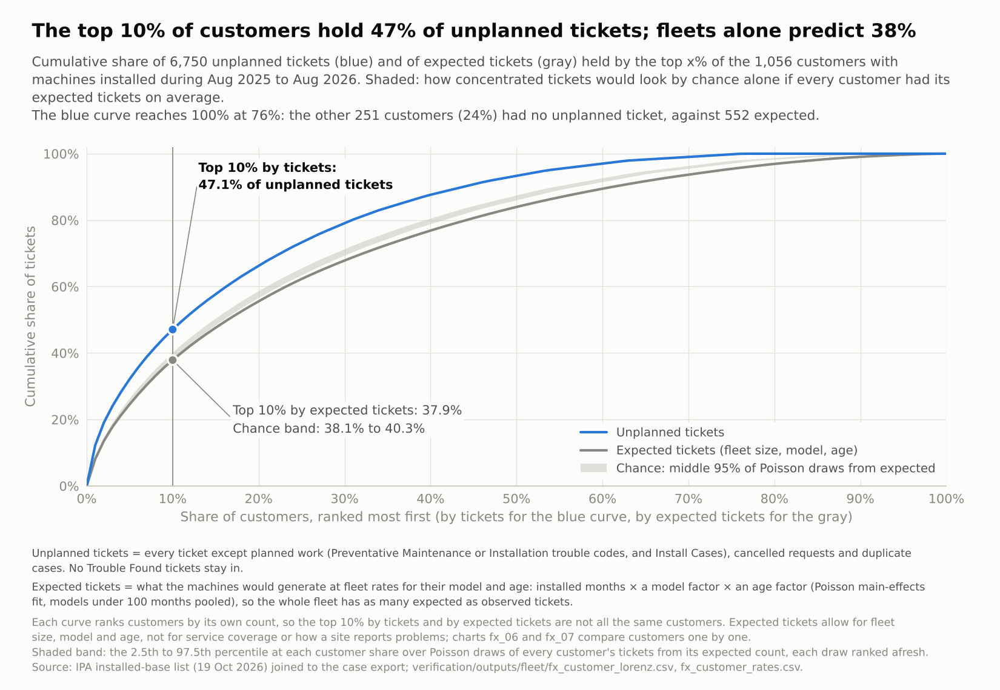

# Ticket rates adjusted for fleet exposure

*21 October 2026. Script: `verification/fleet_exposure.py`. It runs locally in about 40 s from the case export and
IPA's installed-base list, with no database, and has 27 self-checks. Every number below is in
`verification/outputs/fleet/fx_summary.json` or an `fx_*.csv`. Figures: `viz/figures/fx_*.png`, drawn by one plain
matplotlib script per chart in `viz/fleet_exposure/`. They replace high_ticket charts 9 and 10, which are
retired.*

**How this was checked.** Two clean-room builds, written from the definitions without reading the script,
reproduced every number. One fitted the expected counts by IPF, the other by its own Poisson regression. The
reproduction covers:
- the fleet totals;
- all model and age rates;
- every customer's observed and expected tickets;
- all 12 method variants;
- the consistent-outlier lists;
- the persistence statistics.

Bootstrap and permutation intervals agree within Monte Carlo noise. A statistical review then led to six
changes, all applied here:
- intervals for groups held by few accounts;
- age-standardised model comparisons;
- leaving out a third-party service plan;
- a symmetric rule for consistently low customers;
- out-of-sample and same-site nulls for persistence;
- a bound for machines missing from the list.

## Bottom line
1. **IPA's list makes exposure-adjusted rates possible for models and customers.**
   - It holds 9,294 active machines with account, model and install date.
   - 94% of ticket rows match a listed serial. Where they match, the account agrees 99.4% of the time and the
     model always.
   - The fleet rate is **6.2 unplanned tickets per 100 installed machine-months**, about 0.74 per machine per year.
2. **The busiest models' ticket counts mostly reflect fleet size; about half of their higher rate is machine
   age.**
   - The three models with the most tickets hold 42% of installed machine-months and 51% of unplanned tickets
     (chart fx_01). They are LVD-Remote-2.0, LVRR-WP-2.0 and MV-2.0.
   - LVD-Remote-2.0 and LVRR-WP-2.0 run at 8.0 and 7.7 per 100, 30% and 26% above the fleet. Age for age they are
     16% (95% interval 5–28%) and 12% (1–25%) above.
   - scrubBank 480 is clearly higher: 16.4 per 100, 2.7 times the fleet and 2.6 times age for age (1.8–3.8),
     and above it in both halves.
   - alEx SD 2.0 (1.8 times age for age, 1.3–2.4) and SD-64 (1.5 times, 1.1–2.2) are above over the year, but
     not clearly in each half.
   - A-series machines generate almost no tickets.
3. **Machine age matters.**
   - Machines under 4 years old generate about 8 tickets per 100 machine-months; machines 10 years or older, 2.5.
   - The oldest band's low rate is partly service status: 83 of its 164 machines with a ticket are Not
     Serviceable. It is also partly machines removed before the list was drawn up, so it overstates how much
     tickets fall with age.
   - Service status on the October list: Under Warranty 10.5, No Coverage 4.3, Not Serviceable 1.5.
4. **Customers differ in ticket rate, and the differences tend to last.** We compare each customer with what its
   own machines would generate at fleet rates for their model and age.
   - **63 customers have more tickets than their fleet predicts, beyond chance.** They hold 26% of tickets
     (1,732, against 747 expected).
   - **Customers that run high in the first half of the period tend to run high in the second.** The rank
     correlation is 0.46, against 0.04 when the halves are shuffled between customers of similar size.
   - That holds for customers as a group. Any single customer on a list could still be there by chance (§5).
   - Customer 029, which has the most unplanned tickets on listed machines (one more than Customer 171), is in
     line with its fleet: 114 tickets against 102 expected on 107 machines.
5. **18 customers are consistent outliers.**
   - Each is flagged under at least 10 of 12 method variants, and above expected beyond chance in each half of the
     period (Poisson p < 0.05 in each).
   - Together they have 737 tickets against 318 expected.
   - Nine have fewer than 10 machines.
   - Of the nine larger ones, six have their excess spread across their machines: the top two hold under half of
     it. That fits something site-wide better than one bad unit: heavy use, the environment, service coverage or
     how readily staff call. The data cannot say which.
   - Only one is outside the normal spread between customers (the overdispersion-adjusted funnel). The list is for
     a field check, not a verdict.
6. **Machine-level outliers persist too, but less than they first appear.**
   - On installed exposure, 128 machines are flagged, and 36 are consistent outliers.
   - Of docs/05's 113 flagged machines, 106 are on the list and 93 of those stay flagged.
   - The 70 machines above expected beyond chance on the first half alone (Poisson, BH q < 0.05) ran at 12.6 times
     their expected tickets then. In the second half they ran at 2.9 times: picking machines on their worst months
     exaggerates how far out they are, but they stay well above expected.

## 1. The data
**IPA's active equipment list (19 October 2026).**
- **Contents:** 9,294 machines at 1,066 accounts; 34 models in 4 product families (plus one machine labelled "scrubEx 1.0").
- **Fields used:** serial, account, model, product family, service status, service plan, ownership, country,
  install date and go-live date.
- **Fields dropped when loaded** (`common.load_equipment`), so they never reach an analysis table:
  - address, city, zip and phone;
  - location, poll position and credentialing;
  - last PM date and contract expiry.
- **Pseudonyms:** accounts and serials that never appear on a ticket get new pseudonyms after the existing ones
  (`common.extend_maps`: Customer 846 onward, S03774 onward). Every existing label is unchanged.

**Match with the case export** (`fx_match.csv`):

| Measure | Value |
|---|---|
| Ticket serials on the list | 3,540 of 3,773 (93.8%) |
| Ticket rows whose serial is on the list | 7,018 of 7,471 (93.9%) |
| Matched rows where the ticket account = the list account | 6,978 of 7,018 (99.4%) |
| Matched rows where the ticket model = the list model | 7,018 of 7,018 |
| Unplanned tickets on unlisted serials | 433 (226 serials) |

**Machines missing from the list.** The list holds only machines active on 19 October 2026, so machines removed
during the period are missing.
- **Evidence:** the share of unplanned tickets on unlisted serials falls from 11.1% in August 2025 to 1.0% in
  August 2026 (`fx_unlisted_by_month.csv`). Those tickets drop out with their unknown exposure.
- **Older models lose most:**
  - 10–33% of the tickets of several older models are on unlisted serials;
  - the scrubEx 2.0 models lose 1.5% or less, and alEx SD 2.0 2% (`fx_unlisted_by_model.csv`).
- **Bound:** adding the unlisted tickets back with the least exposure they could have had (from their first to
  their last ticket in the period) gives an upper bound for each model's rate. It moves some older models' rates up
  noticeably, the scrubEx 2.0 models' by about 0.1 (at most 0.11, LVRR-WP-2.0) and alEx SD 2.0's by 0.25. For
  example:
  - alEx LC-D: 8.0 → at most 9.4;
  - LVD-Remote: 5.7 → at most 6.4.
- **Effect on comparisons:** older models are understated relative to newer ones. The bound is in the
  `rate_with_unlisted_max` column of `fx_model_rates.csv`.

**Third-party service plan left out.** All 239 machines on the Vogeltronix service plan sit at one account.
- **Evidence:** they had 3 unplanned tickets in 2,998 machine-months, 0.1 per 100 against 6.2 for all other plans
  together (Ricoh 6.2, Bell and Howell 6.0).
- **Interpretation:** their service work rarely reaches this case export (3 tickets), most likely because the third
  party handles it; IPA is asked to confirm (§8, ask 2). They are left out of every rate and comparison.
- **Sensitivity:** with them included, the fleet rate is 6.0 and the customer flags change little (70 instead of
  63).
- **Why it matters:** left in, this one account would have supplied about 44% of the gamma-Poisson
  customer-dispersion estimate (0.52 with it, 0.30 without), lowered several models' rates and shown up as a
  "consistently low" customer.

**Population.** 9,055 machines at 1,065 accounts. 109 machines were installed after the period and count 0 months;
9 accounts have only such machines, so 1,056 accounts have machines installed during the period.

## 2. Definitions
- **Installed machine-month:** one month (30.4 days) of a listed machine being installed, from its install date (or
  1 August 2025 if earlier) to 31 August 2026.
  - Four machines had a ticket before their install date (7 tickets). The list's date is the install at the current
    account, so their exposure starts at that ticket.
  - Go-live dates instead of install dates (for exposure; age bands stay on install dates) give 6.17 instead of
    6.16.
- **Unplanned tickets:** Zac's definition. Every ticket except planned work, cancelled requests and duplicates. No
  Trouble Found stays in.
- **Expected tickets:** what a group's machines would generate at fleet rates for their model and age.
  - It comes from a Poisson main-effects fit (installed months × a model factor × an age-band factor). In total,
    it equals the observed count for every model and every age band.
  - Models with under 100 installed months share one pooled rate.
  - Age is years since install at the midpoint of each machine's exposure.
- **STR (standardised ticket ratio):** observed ÷ expected.
- **Age-standardised ratio (models):** a model's tickets ÷ what its machines would generate at the fleet's rate for
  their age, from the same joint fit. 1 means in line with the fleet once age is allowed for.
- **Flagged:** the same rule for customers and machines, as in docs/05. Both of these hold:
  - 5 or more unplanned tickets;
  - more than expected beyond chance (Poisson test, Benjamini–Hochberg q < 0.05).
- **Outside the funnel:** above the 99.8% limit of an overdispersion-adjusted funnel (Spiegelhalter 2005). Such a
  customer is unusual even among customers, not just beyond chance.
- **Consistent outlier:** both of these hold:
  - flagged in at least 10 of 12 method variants. The variants are:
    - three adjustments (model; model + age; model + age + coverage);
    - × tickets or 7-day episodes;
    - × with or without monitoring-template and No Trouble Found tickets;
  - above expected beyond chance in each half of the period (1 August 2025 to 14 February 2026; 15 February to 31
    August 2026; Poisson p < 0.05 in each).
- **Consistently low:** the mirror image of a consistent outlier.
- **Intervals:** 95%, from a cluster bootstrap that resamples accounts, because tickets cluster within a customer.
  - For a group held by fewer than 10 accounts, or with no tickets, the bootstrap interval is degenerate. The
    reported interval is then the wider of the bootstrap and the exact Poisson (Byar) interval.
  - A group held by one account is "not estimable" against the fleet.
  - Age-standardised ratios re-fit the joint model + age fit in every resample, so their intervals include the
    uncertainty of the age factors.

**Three fleet rates.**

| Rate per 100 | Measure | Machines | Period |
|---|---|---|---|
| 7.11 | Zac's: months with at least one transaction | Telemetry devices matched to tickets | Aug 2025–Jul 2026 |
| 6.98 | Telemetry span: every month between a device's first and last transaction | 6,423 telemetry devices with exposure; tickets inside each device's span | Aug 2025–Jul 2026 |
| **6.16** | **Installed: every month on the installed base** | **9,055 listed machines**, networked or not | **Aug 2025–Aug 2026** |

The installed rate is the lowest because its denominator counts every installed month. That includes:
- machines with no telemetry;
- months when a machine transacts nothing;
- the 5,598 machines with no unplanned ticket.

The telemetry-span figure here (6.98) counts only tickets inside each device's active span. docs/05's 7.5 also
counted 227 tickets outside the span and tickets on devices with no exposure.

## 3. Rates by model, family, age and coverage
**Models** (`fx_model_rates.csv`; chart `fx_02`). The table covers the models with the most tickets plus the
extremes. "Age-standardised" allows for each model's age mix.

| Model | Machines | Tickets | Rate per 100 | 95% interval | Age-standardised ratio |
|---|---|---|---|---|---|
| LVD-Remote-2.0 | 1,452 | 1,381 | 8.0 | 7.3–8.9 | 1.16 (1.05–1.28) |
| LVRR-WP-2.0 | 1,305 | 1,193 | 7.7 | 6.9–8.6 | 1.12 (1.01–1.25) |
| MV-2.0 | 1,151 | 883 | 6.4 | 5.7–7.2 | 0.93 (0.84–1.04) |
| LVD-Remote | 832 | 615 | 5.7 | 4.9–6.4 | 1.14 (0.97–1.36) |
| LVRR-WP | 873 | 495 | 4.4 | 3.7–5.1 | 0.84 (0.69–1.01) |
| alEx LC-D | 551 | 466 | 8.0 | 6.3–9.9 | 1.05 (0.83–1.32) |
| MV | 602 | 380 | 4.9 | 3.9–5.9 | 1.01 (0.80–1.24) |
| alEx SD 2.0 | 98 | 150 | 12.9 | 9.4–16.9 | 1.82 (1.32–2.37) |
| scrubBank 480 | 58 | 122 | 16.4 | 11.3–22.5 | 2.58 (1.75–3.79) |
| A-LC | 345 | 39 | 0.9 | 0.4–1.4 | 0.16 (0.07–0.26) |
| A-MC | 112 | 3 | 0.2 | 0.0–0.6 | 0.04 (0.00–0.11) |

**What the model table shows:**
- **About half of the 2.0 models' lead is their youth.**
  - LVD-Remote-2.0 is 30% above the fleet on crude rates and 16% above once age is allowed for.
  - LVD-Remote-2.0 and MV-2.0 are no worse than their predecessors age for age: 1.16 against LVD-Remote's 1.14,
    and 0.93 against MV's 1.01.
  - LVRR-WP-2.0 is higher than LVRR-WP: 1.12 against 0.84. The survivorship bound narrows that gap (LVRR-WP's
    rate rises from 4.4 to at most 4.9) but does not close it.
- **The A-series (A-LC, A-MC, A-SC) generate almost no tickets in this export.** The A-series is also poorly
  matched to telemetry (docs/03), so its service may run through another channel. This is a question for IPA.

**Families** (`fx_family_rates.csv`):
- scrubBank 12.3 per 100 (above the fleet);
- scrubEx 6.4 (not different);
- alEx 5.2 (below).

**Age** (`fx_age_rates.csv`; chart `fx_03`):

| Age band | <1 | 1–2 | 2–4 | 4–6 | 6–8 | 8–10 | 10+ |
|---|---|---|---|---|---|---|---|
| Rate per 100 | 8.4 | 7.8 | 7.9 | 5.0 | 5.5 | 5.6 | 2.5 |

**Service status, as on the October 2026 list** (`fx_coverage_rates.csv`; chart `fx_04`):

| Status | Rate per 100 |
|---|---|
| Under Warranty | 10.5 |
| Service Contract | 7.5 |
| No Coverage | 4.3 |
| Not Serviceable | 1.5 |

- **Snapshot caveat:** the status is the one on the October 2026 list, applied to the whole period. Warranty
  machines are mostly new installs, so part of their rate is early-life failure.
- **Low statuses:** the low rates for No Coverage and Not Serviceable probably reflect fewer calls reaching IPA,
  not more reliable machines.
- **Why coverage is not adjusted for:** coverage is partly a customer choice, and the status is a snapshot. It
  appears in one of the method variants and as context.

**Telemetry types, interim** (`fx_type_rates.csv`; chart `fx_05`):
- **Why interim:** installed exposure needs the device list joined to the installed-base list, which needs the
  database (section 7). Until then, telemetry types use telemetry-span exposure (12 months; tickets inside each
  device's span).
- **Above the telemetry fleet's 7.0:**
  - scrubex2.0-2 7.9 and scrubex2.0-3 7.9, the types of LVD-Remote-2.0 and LVRR-WP-2.0;
  - sbsx-51 20.1.
- **Below it:** scrubex-5 4.0, scrubex-3 4.3 and scrubex-4 4.8.

## 4. Customers
**The busiest customers against their fleets** (`fx_customer_rates.csv`; chart `fx_06`).
- **Expected:** each customer's expected count comes from its own machines' models, ages and installed months.
- **Top 15 by tickets:**
  - 10 of them have more tickets than their fleet predicts (flagged), and 6 of those are consistent outliers.
  - The first, Customer 029 (107 machines), is in line with its fleet: 114 tickets against 102 expected, STR
    1.11.
  - Customer 171, the busiest in Zac's workload chart, has 113 tickets against 59 expected (STR 1.91) and is a
    consistent outlier.

**How many customers stand out** (chart `fx_07`).
- **Flagged:** 63 customers have more tickets than their fleet predicts, beyond chance. They hold 1,732 tickets
  (26% of the total) against 747 expected.
- **Overdispersion:** customers differ far more than Poisson chance allows (winsorised dispersion 3.3).
- **The funnel:** the overdispersion-adjusted funnel treats that spread as normal. Only one customer is outside its
  99.8% limit, and 32 are above its 95% limit.
- **What the two answers mean:**
  - The Poisson flag answers "is this customer's own rate above the fleet's for the same machines?";
  - the funnel answers "is it unusual among customers?";
  - the persistence results below show the differences are real, so the first question is the useful screen.

**Concentration** (`fx_customer_lorenz.csv`; chart `fx_08`).
- The top 10% of customers by tickets hold 47% of unplanned tickets.
- Ranked by expected tickets, the top 10% of fleets would hold 38%, and Poisson chance on top gives 39% (95% band
  38–40%).
- So most of the concentration is fleet size and mix, and about 8 points are customers running hot.

## 5. Consistent outliers
**Persistence: do customers that run high stay high?** (`fx_outlier_persistence.csv`; charts `fx_10`,
`fx_11`). The customer statistics cover the 311 customers with at least 3 expected tickets in each half.

| Statistic | Observed | If not persistent (permutation null: median, 95% range) |
|---|---|---|
| Rank correlation of STR, first half vs second half | 0.46 | 0.04 (−0.07 to 0.15) |
| Top 10% in the first half also top 10% in the second | 28% | 9% (3% to 22%) |
| Significant (p < 0.05) in both halves | 15 customers | 6 (2 to 10) |
| Above expected beyond chance in the first half (BH q < 0.05; 23 customers) and significant in the second | 43% | 17% (4% to 30%) |
| Above expected beyond chance in the second half (16 customers) and significant in the first | 38% | 13% (0% to 31%) |

- The permutation null shuffles second-half results among customers of similar size. It keeps the spread between
  customers but removes persistence.
- Pure Poisson chance gives a correlation near 0 and almost no significant customers.
- These results hold for customers as a group. Any single customer can still be on a list by chance: about 6 of
  the 15 "significant in both halves" would be expected under the permutation null.
- We have not measured how many of the 18 consistent outliers chance alone would produce. 8 of the 18 have under 3
  expected tickets in a half, so they are outside these statistics.

**Customers** (`fx_outlier_customers.csv`, `fx_outlier_drivers.csv`; chart `fx_12`).
- 32 customers are flagged in at least 10 of the 12 variants. 18 of them are also above expected beyond chance in
  each half (Poisson p < 0.05 in each): the **consistent outliers**.
- Together they have 737 unplanned tickets against 318 expected, with STRs from 1.8 to 5.2 (median 3.0).
- **Fleet size and spread:**
  - 9 have fewer than 10 machines. A few machines can drive those, so a field check should look at the machines
    first.
  - Of the 9 larger ones, 6 have their excess spread across their machines: their top two machines account for
    under half of it.
  - Those 6 are Customers 056, 171, 363, 479, 529 and 641. A spread-out excess fits something site-wide better
    than one bad unit: heavy use, the environment, service coverage or how readily staff call. The data cannot
    say which.
- **Top categories:** Deposit Door at 7 customers, Computer Board at 4 (at one of them tied with two other
  categories), Curtain at 4.
- **Funnel position:** only one is outside the overdispersion-adjusted 99.8% funnel limit, and 7 are inside its
  95% limit. The list is a screening list for IPA's field check, not a verdict.
- **Consistently low customers:** 5, with 0 to 8 tickets against 9 to 30 expected. Two have mostly No Coverage or
  Not Serviceable machines. Low counts are more likely tickets not reaching IPA than better machines.

**Machines** (`fx_machine_flags.csv`, `fx_outlier_machine_persistence.csv`).
- **Flags:**
  - 128 listed machines are flagged on installed exposure (953 tickets);
  - 58 are flagged in at least 10 of 12 variants;
  - 36 are consistent outliers, at 31 customers (14 of them at consistent-outlier customers).
  - A negative-binomial check, which allows for the spread between machines, now flags none (docs/05's
    telemetry-based check left 2). These are
    machines high within a heterogeneous fleet, not a separate population.
- **Persistence:** machines with 3 or more tickets in the first half had 2.6 times their expected tickets in the
  second half. The two nulls give:
  - permuting first-half counts within model and age cells: 1.05;
  - permuting among machines of the same customer: 1.45, so site effects explain part of it, but not all.
- **Regression to the mean:** the 70 machines above expected beyond chance on the first half alone (BH q < 0.05)
  ran at 12.6 times expected then and 2.9 times in the second half.
- **docs/05's 113:**
  - 106 are in the population and 93 of them stay flagged; 30 are consistent outliers.
  - Of the 22 with under 12 telemetry months, 19 are listed. 7 of those were installed during the period, so their
    short exposure was real; 12 were installed earlier and had quiet months.
  - 16 of the 19 stay flagged.

**Models** (`fx_outlier_models.csv`; chart `fx_09`).
- On age-standardised ratios, scrubBank 480 is above the fleet in both halves (2.65 and 2.56).
- A-LC and A-MC are below in both.
- LVD-Remote-2.0 is above on the full period (1.16, 1.05–1.28) and in the first half. In the second half it is
  1.13 with a lower bound just under 1 (0.995). alEx SD 2.0 is the mirror image.

## 6. Limits
- **Machines missing from the list.** Removed machines are missing, so older models are understated (section 1).
- **Snapshots.**
  - Account and service status are as of October 2026.
  - 40 matched ticket rows name a different account from the list, which suggests relocations; the earlier
    account's exposure is lost.
- **Facility, not health system.** The list's account is the facility. Parent accounts are still needed for
  health-system rates.
- **Overdispersion.** Poisson-based flags treat tickets as independent within a customer. Repeat contact and
  site-level effects make them partly dependent, so the flags are screens. Two checks reduce the role of chance
  but do not remove it:
  - the 7-day-episode variants;
  - the requirement to hold in both halves. Under the shuffle null, about 6 of the 15 customers significant in
    both halves pass by chance (§5).
- **Telemetry types** are interim until the database extract is run.

## 7. Telemetry types on installed exposure: the database extract
`verification/fleet_db_extract.py` does the join on the analyst's machine.
- **Inputs:** the telemetry database's device list and each device's first and last transaction.
- **Join:** it attaches the installed-base list and writes pseudonymous files to `verification/outputs/fleet/db/`.
- **Testing:** it is tested on the synthetic fixture (`verification/tests/run_fixture_tests.py`).

```bash
python3 -I verification/fleet_db_extract.py --db data/raw/ipa_transaction_events_202508_202608.db
zip -r fxdb_out.zip verification/outputs/fleet/db      # upload this
```

With those files present, `python3 -I verification/fleet_exposure.py` produces three things:
- telemetry-type rates on installed exposure;
- networked vs non-networked rates;
- the full model × telemetry-type crosswalk.

No code change is needed.

## 8. Questions for IPA
1. **Machines removed or replaced during August 2025 to August 2026, with removal dates.** 433 unplanned tickets
   sit on 226 serials that are not on the active list.
2. **The Vogeltronix service plan.**
   - Does its service work reach Salesforce?
   - Are there other plans like it?
3. **What "Not Serviceable" means**, and whether those machines can generate tickets.
4. **The A-series.** A-LC, A-MC and A-SC generate almost no tickets: is their service handled elsewhere?
5. **Coverage history** (contract and warranty start and end dates), so coverage can vary over the period.
6. **Parent accounts** for health-system rates.
7. **A field check of the 18 consistent-outlier customers** and the 36 consistent-outlier machines. The list is
   available on request.

## Figures
Drawn by `viz/fleet_exposure/fx_*.py` (`python3 -I viz/fleet_exposure/run_all.py`). Each chart prints the
definitions of the terms it uses and checks every number it draws against the outputs.





## Privacy
- **Public outputs:** `verification/outputs/fleet/` holds only pseudonyms (Customer NNN, S#####), labels and
  aggregates.
- **Privacy scan:** the script scans every public text column and every string in the summary for real account
  names, addresses, cities, location labels, serials, case numbers, zips and phones. It matches case-insensitively,
  as word n-grams and as digit tokens, and finds none.
- **Real names:** they go only to `data/private/fx_private_customer_names.csv`. The real-name chart variants go to
  `deliverables/`. Both are gitignored.
