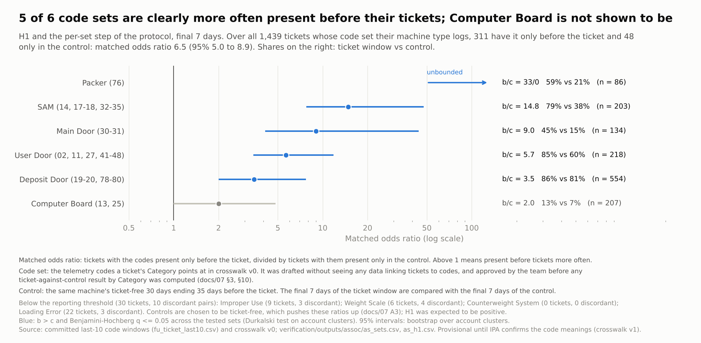

# Association study results: ticket fields and the telemetry codes before each ticket

*22 October 2026. Script: `verification/association.py`. It runs locally in about 2 minutes from committed outputs
only, with no raw file and no database, and has 153 self-checks. Every result below is in
`verification/outputs/assoc/as_summary.json` or an `as_*.csv`; the clean-room cell count comes from docs/07 §14.
Figures: `viz/figures/as_*.png`, drawn by `viz/association/`.*

*The protocol, `docs/07_association_protocol.md`, was frozen before any ticket-against-control result by Category was
computed. Some results were seen while it was planned (docs/07 §10): the TODOS 30-day bucket shares, the 7-day bucket
shares and bucket-level odds ratios, and one Category-level power check.*

*Status: **provisional**. Results use the team-approved crosswalk v0; the confirmatory version, v1, waits for IPA's
code definitions. The text-flag sensitivities (S2, S10) wait for a local run of `verification/flags.py --write`.*

**How this was checked.**
- **Protocol first.** docs/07 pre-specified the population, outcome, hypotheses, estimators, decision rules and 13
  sensitivities. The crosswalk was drafted blind, signed off by the team and frozen by hash.
- **Blind clean-room builds.** Two independent clean-room builds, written from docs/07 alone, each in its own copy of
  the repository, reproduced every one of the 33,515 compared table cells exactly. That includes bootstrap intervals
  and permutation p-values.
  - The comparison ran while this script's outcomes were still hidden: it printed only "agree" or "disagree" per
    cell.
  - The readings settled during that comparison are dated amendments in docs/07 §14, committed before unblinding.
- **Skeptic review (item 8).** Five independent reviewers checked statistics, recency and item 4, strata and
  sensitivities, wording and privacy, and traced every number. A second reviewer then tried to refute each major
  finding; none of the 45 findings was refuted. All are applied here:
  - **Corrected readings:**
    - the item 4 bounds;
    - what the specificity ratio measures;
    - H2b;
    - the repeat-ticket and No Trouble Found rows;
    - the scope by machine family;
    - the blinding claim.
  - **Pre-specified items that had been computed but not reported, or not computed, now done:**
    - S13 in full;
    - the S1 Cancelled-request row;
    - the control-side guard bounds;
    - per-set results by machine type;
    - the 30-day item 4 interval.
  - **Exploratory additions, labelled where they appear:**
    - item 4 for unrelated code sets;
    - precision by look-back.

## Bottom line
1. **On average over the five code sets that could be tested, a ticket's Category agrees with the codes logged just
   before it.** This is H2a, the protocol's primary test, and it succeeds.
   - **The comparison.** Take tickets where the codes their Category points at appear in only one of two periods:
     - the final 7 days before the ticket;
     - the final 7 days of a ticket-free stretch on the same machine 35 days earlier.

     For a ticket's own codes, that split is 269 before the ticket against 47 in the control, about 6 to 1. For the
     same code sets before tickets for other faults it is 644 against 321, about 2 to 1; a ticket counts once for each
     set it is compared on. Compared within machine type and quarter, the first split is **3.2 times** the second.
   - **The numbers.** 95% interval 2.3 to 4.8; permutation p = 0.0005, the smallest possible with 2,000 permutations
     (`as_h2a.csv`; chart as_01).
   - **How to read it.** This specificity ratio compares odds, not shares. It does not mean the codes' share rises 3.2
     times as much.
2. **By code set the estimates are imprecise.**

   | Code set | Specificity ratio (95%) |
   |---|---|
   | SAM | 8.0 (3.5 to 34.8) |
   | User Door | 4.9 (2.5 to 12.5) |
   | Deposit Door | 4.4 (1.6 to 34.3) |
   | Main Door | 2.6 (1.01 to 30.7; permutation p = 0.08) |
   | Computer Board | 0.5 (0.2 to 1.3) |

   - **No ranking.** The first four intervals overlap, so the data do not rank them.
   - **Computer Board.** Its codes, mainly 25, rise at least as much before other faults' tickets. So these data do not
     show a Computer Board-specific match.
   - **Packer.** All 33 of its discordant pairs point to the ticket window, across 32 accounts. Its ratio therefore has
     a zero, and the entry rule leaves it out of the pooled test. Including it would raise the pooled ratio from 3.2
     to 3.7, so leaving it out does not inflate the result.
3. **The codes are concentrated in the final hours.** Among the 1,439 tickets whose Category has a code set that their
   machine type logs:

   | Window before the ticket | Ticket window | Control |
   |---|---|---|
   | Final 30 minutes | 23% | 2% |
   | 7 days | 68% | 50% |
   | 30 days | 76% | 65% |

   (`as_recency.csv`; chart as_02)
   - **For a retrospective linker:** look first at the final hours, and expect to miss many tickets.
     - **Precision.** Among tickets showing a set's codes in the final 2 hours, about 42% have the matching Category,
       against 19% over 7 days.
     - **Recall.** The final 2 hours catch the codes for only 39% of tickets (exploratory).
     - **Recency is not the fault.** Codes of unrelated sets also rise in the final hours (11% vs 3% at 30 minutes), so
       recency alone does not identify the fault.
4. **Part of the code signal is owed to whatever led to the ticket, if the control is a fair stand-in** (`as_item4.csv`).
   The base is the tickets with their own code set in the final 7 days.
   - **Whole week.** Between 27% (95% 23% to 30%) and 73% would have had no code from the set all week without
     whatever led to the ticket. The rest would have had one anyway, as background.
   - **Final hours.** For at least 49% (95% 45% to 53%), something put a code from the set into the final 6 hours where
     there would otherwise have been none. Some of these tickets would still have had a code earlier in the week, so
     this is not a tighter version of the 27%. It is the best of six windows, which makes it slightly optimistic.
   - **Not specific to the Category.** These fractions count everything that sets the hours before a ticket apart from
     the control: the failing machine in general, and the call itself. For codes of unrelated sets the same 6-hour
     figure is 20% (exploratory). Whether the codes match the Category is H2a's question.
   - **What these are.** Bounds, not estimates.
5. **At 7 days, robust to every sensitivity that could be computed.** The pooled specificity ratio stays between 2.3
   and 3.5, with its interval above 1, in all of these (`as_sensitivities.csv`):
   - guard bands that drop the final 30 or 60 minutes from both windows (S3);
   - a matched ticket-free lead-in (S4);
   - dropping recently activated or recently installed machines (S5);
   - undetermined pairs counted either way (S7);
   - planned, cancelled and duplicate tickets put back (S1);
   - machine-level clusters (S8);
   - Deposit Door without its two user-behaviour codes (S13: 3.5 pooled, and Deposit Door itself 6.2);
   - truncated windows (S6). 510 of the 800 added pairs have a control with no events at all, so this mainly checks
     that empty controls do not reverse the result.

   At 30 days (secondary), the matched lead-in (S4) leaves the ratio at 1.4 with an interval from 0.97 to 2.3.
6. **What this does not show.**
   - **Prediction.** It does not show that codes predict tickets, because only the weeks before tickets were examined.
   - **Correctness.** It does not show that Categories are correct, or that the provisional code meanings are IPA's.
   - **Built-in agreement.** If technicians read clearView when they set Category, part of the agreement is built in.
     That question is open with IPA. The text-flag sensitivity (S2) that bounds it from the ticket text is pending.
   - **Other machine families.** The Category results rest almost entirely on scrubex machines. alEx and mlc
     machines, about one pair in five, seldom log the codes their Categories point at. So the study cannot say whether
     Category agrees with the codes on them (§7).

## 1. The data
- **Primary population** (docs/07 A3): 2,950 unplanned tickets on 2,376 machines, opened 5 October 2025 to
  28 August 2026. Each ticket has:
  - a 30-day window before the ticket;
  - a clean control window on the same machine 35 days earlier;
  - no other ticket in either window;
  - telemetry on the machine at the time.
- **Pairs at 7 days.** 2,911 tickets on 2,350 machines and 610 account clusters. 39 pairs leave because one of their
  windows has more than 10 distinct codes, so the window cannot show whether a code fell in the final 7 days (A8).
- **Mapped tickets.** 1,706 of the 2,911 have a Category with a code set; they are the base of H2a.
- **H1.** It uses the 1,439 tickets on machine types that log their own set (A10). 267 mapped tickets cannot be checked
  that way (§6).
- **Reproductions.** The TODOS first look is reproduced exactly: 3,259 paired tickets; Electronics 20.3% vs 13.1%, Door
  67.9% vs 61.1%. So is every count docs/07 states (`as_summary.json`, `pinned_counts`).

## 2. H2a, the primary test: specificity (`as_h2a.csv`; chart as_01)
**Pooled H2a at 7 days:** specificity ratio 3.22 (95% 2.34 to 4.77); one-sided permutation p = 0.0005.
- **How it was computed.**
  - **The ratio.** For one code set, consider tickets with the set's codes in only one of the two windows. The ratio is
    the split "only before the ticket" to "only in the control" for tickets whose Category points at the set, divided
    by the same split for tickets of other faults on machine types that log the set. It is pooled with
    Mantel–Haenszel within machine type × quarter.
  - **The test.** Category was shuffled within those strata 2,000 times. The interval is a bootstrap over 610 account
    clusters.
- **Decision.** H2a succeeds.

**Per set** (descriptive; only the pooled test decides):

| Code set | Ticket-set pairs, target / comparator | Discordant, target (b / c) | Specificity ratio (95%) | Permutation p |
|---|---|---|---|---|
| SAM (14, 17–18, 32–35) | 203 / 746 | 89 / 6 | 8.0 (3.5–34.8) | 0.0005 |
| User Door (02, 11, 27, 41–48) | 218 / 939 | 68 / 12 | 4.9 (2.5–12.5) | 0.0005 |
| Deposit Door (19–20, 78–80) | 554 / 376 | 45 / 13 | 4.4 (1.6–34.3) | 0.0015 |
| Main Door (30–31) | 134 / 815 | 45 / 5 | 2.6 (1.01–30.7) | 0.077 |
| Computer Board (13, 25) | 207 / 1,143 | 22 / 11 | 0.5 (0.2–1.3) | 0.91 |

**Not in the pooled test** (entry rule, docs/07 §4):
- **Packer:** b = 33 and c = 0 on the target side. Including it would give 3.7.
- **Improper Use, Weight Scale and Loading Error:** 3, 4 and 3 discordant pairs.
- **Counterweight System:** its codes 66 and 67 are logged only by sbsx machines, and its tickets are on alEx and mlc.

**Computer Board's codes are not shown to be specific.**
- Code 25, "No Communications with Dispenser", rises before tickets in general: 10.8% vs 3.5%, matched OR 4.5 (§4).
- It rises at least as much before tickets for other faults.
- Which board code 13 refers to, and whether 25 is a symptom of many faults, are questions for IPA (§7).

**Deposit Door does not rest on its user-behaviour codes** (S13).
- Without 19 "Deposit Door not Opened" and 78 "Receiver Deposit Door not completely opened", Deposit Door's ratio is
  6.2 (95% 2.7 to 15.8). The pooled ratio is 3.5 (2.6 to 5.2).
- Source: `as_sensitivities.csv`, S13 row; `as_negative_controls.csv`.

**30 days (TODOS outcome, secondary):** 1.90 (1.39 to 2.75), p = 0.001. This is not a like-for-like comparison with
7 days.
- **Different sets enter.** Deposit Door cannot enter, because of a zero in its ratio, while Packer does. That gives 868
  target ticket-set pairs against 1,316.
- **Lower within sets.** User Door is 2.7 and Main Door 2.0.
- **Computer Board.** At 30 days its codes rise clearly less before its tickets than before others: 0.32 (0.14 to
  0.61).

**H2b (descriptive; no claim rests on it, docs/07 §4).** Fault tickets against the 278 Not-in-telemetry tickets, mostly
Network: specificity ratio 8.8 (95% 5.0 to 22.8), permutation p = 0.0005 (`as_h2b.csv`).
- **Why it is higher than H2a's 3.2.** Mainly because the fault codes do not rise before these tickets as they do
  before tickets for other faults.
- **Read its size loosely.**
  - The comparator is small.
  - Before Network tickets, codes of every kind are less common than in the control: any code 64.5% vs 76.1% at
    7 days, 197 pairs (`as_item2_breakdowns.csv`). That is as expected if the machine has lost its connection. Power
    tickets do not show this.
  - That pulls the comparator's split below 1 (57 against 72) and lifts the ratio.

## 3. H1 and the per-set step (`as_h1.csv`, `as_sets.csv`; chart as_03)
**H1** (tested, because H2a succeeded). Of 1,439 tickets on machine types that log their own set:
- 311 have it in the final 7 days before the ticket but not in the control, and 48 the reverse.
- Matched odds ratio 6.5 (95% 5.0 to 8.9); Durkalski p < 0.001. H1 succeeds.
- **Caveat.** H1 was expected to be positive (docs/07 §9), and the ticket-free choice of controls also pushes it up
  (§7).

**Per set** (tested, because H1 succeeded): 5 of the 6 sets that meet the reporting threshold are enriched (b > c and
BH q ≤ 0.05).

| Set | Matched odds ratio (95%) | Ticket window vs control |
|---|---|---|
| SAM | 14.8 (7.8–47.5) | 79% vs 38% |
| Main Door | 9.0 (4.1–44) | 45% vs 15% |
| User Door | 5.7 (3.4–11.8) | 85% vs 60% |
| Deposit Door | 3.5 (2.0–7.7) | 86% vs 81% |
| Packer | 33 to 0, unbounded | 59% vs 21% |
| Computer Board (not shown to be enriched) | 2.0 (1.0–4.8); q = 0.08 | — |

## 4. Item 2: enrichment by bucket and by code (`as_item2_buckets.csv`, `as_item2_codes.csv`)
**Final 7 days, 2,911 pairs, machine-cluster intervals.**

| Bucket | Ticket | Control | Matched OR (95%) | BH q |
|---|---|---|---|---|
| Electronics/software/comms | 12.6% | 5.1% | 3.7 (2.9–4.8) | < 0.001 |
| Door issue | 54.1% | 42.6% | 2.4 (2.1–2.8) | < 0.001 |
| Operational status | 8.4% | 5.5% | 2.1 (1.6–2.7) | < 0.001 |
| Mechanical fault | 40.5% | 36.2% | 1.5 (1.3–1.8) | < 0.001 |
| Stock-out | 39.2% | 40.0% | 0.86 (0.69–1.07) | 0.24 |
| User behavior | 36.3% | 37.7% | 0.78 (0.62–0.96) | 0.04 |
| Incomplete transaction | 26.2% | 26.2% | 1.00 (0.83–1.22) | 1.00 |

- **Not a blind result.** Bucket shares at 7 days were looked at while the protocol was planned (docs/07 §10, look 4).
  This table confirms that look on the primary population; it is not a new prediction. The tests by Category in §2–§3
  were not seen in advance.
- **Frequent codes.** 24 of the 35 frequent codes are enriched before tickets (q ≤ 0.05). One is less common before
  tickets: 04 "Half Garment", 22.4% vs 25.0%.
- **The largest code-level ratios:**
  - the numbered user doors (e.g. 48 "User Door 8 is Open", 22 to 1 discordant);
  - 25 "No Communications with Dispenser" (4.5);
  - 30 "Main Door not Closed" (4.0);
  - 81 "Opening Door Blocked" (3.5).
- **At 30 days (the TODOS window):** Electronics 20.9% vs 13.7% (2.4), Door 71.4% vs 64.0% (2.0), Mechanical 56.9% vs
  54.7% (1.4).
- **Negative control: Stock-out** (codes 03 and 77; docs/07 §4; `as_negative_controls.csv`). Only tickets whose own
  code set has neither code count here, which is every ticket except Loading Error. Intervals use account clusters.
  - **7 days** (2,881 pairs): 39.1% vs 39.9%, matched OR 0.87 (0.69 to 1.09). Codes for a generic "machine in trouble"
    do not rise.
  - **30 days** (2,919 pairs): 48.2% vs 47.1%, matched OR 1.49 (1.07 to 2.10). The 30-day window picks up generic
    differences between the two periods that the 7-day window does not.
- **Breakdowns** by Category and Trouble Code are in `as_item2_breakdowns.csv`. These rows are descriptive, with
  unadjusted p-values.
  - **No Trouble Found tickets** (209 pairs) show door codes more often in the final 7 days than in the control:
    44.0% vs 32.5%, matched OR 3.0. At 30 days there is no clear difference: 59.0% vs 57.1%.
  - **Cancelled requests** (S1's separate row, 89 pairs) show a similar 7-day door rise: 58.4% vs 44.9%, matched OR
    2.7 (95% 1.2 to 8.7). That row is small.
  - **What this cannot tell.** Door codes fit both readings of NTF: a door left open or blocked that was not a fault,
    or an intermittent fault the technician could not reproduce. Which applies is an IPA question (§7).
  - **The 157 tickets left out** at A3 step 1, because another ticket on the machine opened in the 5 days before them:
    146 pairs after the span rule and the 7-day determination. Electronics codes 23.3% vs 4.8%, matched OR 6.4 (32
    vs 5).
    - That is above the overall Electronics row, but not the largest row in the breakdowns.
    - Their 7-day window contains the earlier ticket, the codes that led up to it and possibly its service visit,
      while the control is ticket-free. So the codes may come from the earlier fault or its repair as much as from the
      new call.
    - Whether these are repeat calls on an unfixed fault is not measured (IPA to confirm).

## 5. Item 3: recency (`as_recency.csv`, `as_recency_bins.csv`, `as_guard.csv`; chart as_02)
**Code-set presence, ticket window vs control.** 1,439 tickets up to 7 days, the same tickets at every point; 1,469 at
30 days, which uses the last-10 list.

| Window | Ticket | Control |
|---|---|---|
| 30 min | 23.5% | 1.5% |
| 1 h | 31.3% | 3.5% |
| 2 h | 39.3% | 7.3% |
| 6 h | 47.6% | 13.9% |
| 1 day | 56.2% | 25.9% |
| 7 days | 68.4% | 50.1% |
| 30 days | 75.6% | 65.0% |

**Exclusive bins.** Each ticket is counted once, in the bin of its most recent own code (1,469 tickets):

| Most recent own code | Ticket | Control |
|---|---|---|
| Final 2 hours | 582 (39.6%) | 111 (7.6%) |
| 2–6 h | 124 | 96 |
| 6–24 h | 127 | 177 |
| 1–7 days | 177 | 354 |
| 7–30 days | 100 | 217 |
| None | 352 | 502 |
| Not determinable (list full) | 7 | 12 |

The later bins are smaller before tickets only because most tickets already fall in an earlier bin.

**The ticketing process.**
- **The 30-minute figure.** It lies entirely inside the 30-minute guard band, so it cannot be separated from codes the
  call itself produced, such as the caller trying the machine again.
- **The final-hours pattern does not depend on it.** With the final 30 minutes dropped from both windows, the code set
  is present within 6 hours before 45.1% of tickets, against 12.6% to 13.9% of controls. With the final 60 minutes
  dropped, the figures are 42.3% against 10.9% to 13.9%.
- **The pooled specificity ratio** moves from 3.2 to between 3.1 and 3.3 (S3).
- **Earlier activity.** Activity around the call earlier than the final hour cannot be separated from the fault in this
  data.

## 6. Items 4 and 6: how much the codes explain, and machine types (`as_item4.csv`, `as_match_rates.csv`, `as_by_type.csv`)
**Excess presence fraction (pT − pC)/pT.** If the control is valid, this is a lower bound on the share of tickets with
their own codes in the window that would not have had them there without whatever led to the ticket.

| Window | Lower bound | Upper bound, min(1, (1 − pC)/pT) |
|---|---|---|
| 30 minutes | 0.93 | 1 |
| 2 hours | 0.81 | 1 |
| 1 day | 0.54 | 1 |
| 7 days | 0.27 (95% 0.23–0.30) | 0.73 |
| 30 days | 0.14 (95% 0.11–0.17) | 0.46 |

- **Tightest lower bound** over the windows up to 7 days: 0.49 (95% 0.45 to 0.53, at 6 hours). It is computed as
  (pT(6 h) − pC(6 h))/pT(7 d).
- **Not specific to the Category.** For codes of unrelated sets on the same tickets, the fraction is 0.70 at 30 minutes
  and 0.11 at 7 days, and the 6-hour bound is 0.20 (exploratory, added after unblinding). Much of the final-hours
  fraction is generic activity before a ticket.
- **The validity caveat.** docs/07 A3 lists two ways the control may not be valid, which push in opposite directions.

**Where both windows have the code set** (673 tickets). The ticket window's code is:
- more recent in 76% (72% to 80%);
- more frequent over the 30-day window in 79% (76% to 82%).

If timing carried no information, each would be about 50%. Codes of unrelated sets give 59% and 61% (exploratory), so
part of this is generic too. Counts cover only codes in the last-10 list.

**Match rates** (descriptive; Category is a closure label, not a gold standard). At 7 days, micro-averaged:

| Match | Base | Recall (control) | Precision (control) |
|---|---|---|---|
| Target code present | 1,439 tickets on types that log their set | 68.4% (50.1%) | 19.1% (16.3%) |
| Matching bucket present, as TODOS asks | 2,386 tickets whose Category has a team bucket, of 2,873 with a Category | 48.1% (33.6%) | 21.9% (17.2%) |

- **Pooling.** Micro-averages pool different per-set populations, and one ticket can count in the precision
  denominators of several sets (docs/07 §14.5).
- **Deposit Door dominates.** It supplies 479 of the 984 target-code matches, and its codes are present before 81% of
  its tickets' controls too.
- **Precision by look-back** (exploratory, `as_match_rates.csv`):

  | Look-back | Precision (control) | Recall |
  |---|---|---|
  | Final 30 minutes | 49.8% (14.5%) | 23.5% |
  | 2 hours | 41.9% | 39.3% |
  | 7 days | 19.1% | 68.4% |

**Machine types** (`as_by_type.csv`). Descriptive, with unadjusted p-values and no intervals.
- **Estimable.** The six types that meet the reporting threshold all show enrichment of the ticket's own code set.
  Matched odds ratio b/c:

  | Type | b/c | b to c |
  |---|---|---|
  | scrubex2.0-4 | 13.3 | 53 to 4 |
  | scrubex2.0-5 | 8.0 | 16 to 2 |
  | scrubex2.0-2 | 6.8 | 102 to 15 |
  | scrubex2.0-3 | 6.1 | 43 to 7 |
  | scrubex-4 | 4.8 | 19 to 4 |
  | scrubex-2 | 4.3 | 52 to 12 |

  Per-set rows by type are in the same file.
- **Below the threshold.** The other types have fewer than 30 pairs or fewer than 10 discordant pairs. scrubex-3, for
  example, has 58 pairs but only 2 discordant.
- **Not measured.** 267 of the 1,706 mapped tickets (16%) cannot be checked: 262 are on machine types that do not log
  the ticket's own code set (A10), and 5 are of unknown type. For them the codes can neither confirm nor contradict the
  Category. They include:
  - 100 of 234 Main Door tickets;
  - 83 of 290 Computer Board;
  - all 47 Counterweight System.

## 7. Limits and questions for IPA
**Limits.**
- **One control, always earlier.**
  - **Calendar drift.** S11 measures calendar drift across the fleet. Control-window presence of a ticket's own code
    set rises by about 0.9 points per 35 days, a single pooled estimate. That would add about 1 point to the 18-point
    difference at 7 days.
  - **Change within a machine** over those 35 days (wear, firmware, use) is not measured. H2a removes it only where it
    affects target and comparator code sets equally (docs/07 §11).
- **Controls chosen as ticket-free.** Each control has no ticket in the 30 days after it (docs/07 A3). If bursts of codes
  lead to tickets, this leaves out code-heavy controls. So H1, the item 2 ratios, the recency curve and the item 4
  fractions lean away from no effect. H2a cancels this only if the effect is the same before matching tickets and
  before other tickets, and that is not measured.
- **Who the result describes.** Tickets that follow about two quiet months on the machine. Chronic machines are
  under-represented (docs/05).
- **Mostly one machine family.** H2a, H1, the per-set results, the recency table and item 4 rest almost entirely on
  scrubex machines: 1,402 of the 1,439 H1 tickets, and every machine type with enough tickets to report.
  - alEx and mlc machines account for 568 of the 2,911 pairs.
  - They seldom log the codes their tickets' Categories point at (docs/07 A10), so they add 6 tickets to H1.
  - These results therefore do not show whether Category agrees with the codes on alEx or mlc machines. The item 2
    bucket table does include them.
- **Not yet measured:**
  - the text-flag exclusions (S2);
  - the interval-based clean rule (S10);
  - crosswalk v1 (S12);
  - code support for the 267 mapped tickets on types that do not log their own set.
- **Provisional meanings.** The bucket and code meanings are provisional; IPA to confirm.

**Questions for IPA** (added to TODOS item 9):
- **Code definitions for crosswalk v1,** in particular:
  - **13.** Which board does "Invalid Driver Board Response" refer to?
  - **25.** Is "No Communications with Dispenser" a symptom of many faults rather than of the computer board?
  - **66 and 67.** Which family logs them? They are emitted only by sbsx machines here.
- **Machine families.** Which codes can each family or firmware version emit? alEx and mlc machines seldom log the codes
  for Main Door, Computer Board or Counterweight, so the study says almost nothing about those families.
- **clearView.** Do technicians consult it when they set Category?
- **No Trouble Found.** What does it mean in practice? NTF tickets, and cancelled requests, show door codes rising in
  the final 7 days.

## Figures

## Privacy
- **Public outputs:** `verification/outputs/assoc/` holds only T##### and M##### ids, Customer NNN as cluster labels,
  Categories, codes, machine types and aggregates.
- **Privacy scan:** the script checks every text column and summary string against the pseudonym formats. When the raw
  workbook is present locally, it also checks them against real serials, account names and case numbers.
- **Figures:** the charts show code sets, Categories and counts only, and their run script scans them for
  identifier-like tokens.
